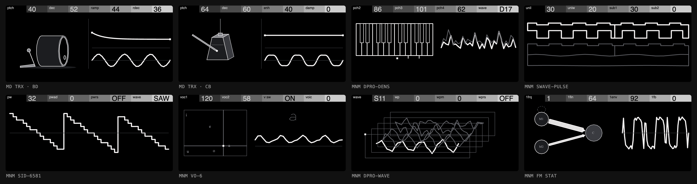

# OP-XY MNMD

The Elektron Machinedrum and Monomachine, written from scratch as engines for
the Teenage Engineering OP-XY, on the
[Open-XY SDK](https://github.com/etcetc000/open-xy).



- **The Machinedrum is four drum kits**, one per family. They play like the
  OP-XY's Drumline: each of the 24 keys holds its own machine (kick, snare,
  toms, clap, rim, cowbell, hats, cymbals and more). Shift and the first
  encoder choose a key's machine, the encoders hold that machine's eight
  controls, and the project saves them.
- **Each Monomachine machine is its own engine**, played chromatically, with
  its SYN page's two rows as two pages of four encoders. A press of any
  encoder switches between them, as on the SDK's Macro Osc.

| Engine | ID | Machines |
| --- | --- | --- |
| MD KIT | `mdkit` | Four families, 33 machines: TRX BD, SD, XT, CP, RS, CB, CH, OH, CY, MA, CL, XC, B2; EFM BD, SD, XT, CP, RS, CB, HH, CY; P-I BD, SD, MT, ML, MA, RS, RC, CC, HH; GND SN, NS, IM |
| MD E12 | `mde12` | E12's 16 machines, on samples you capture from your own ROM |
| MNM SWAVE-SAW | `mmsaw` | A stack of detuned saws with sub-octaves |
| MNM SWAVE-PULSE | `mmpulse` | Detuned pulses with a sweeping width and sub-octaves |
| MNM SWAVE-ENS | `mmens` | A four-voice chord of saws or pulses, with chorus |
| MNM SID-6581 | `mmsid` | Triangle, saw, pulse, mixed and noise, with a pulse-width sweep, ring and sync |
| MNM FM STAT | `mmstat` | Two modulators into one carrier, M1 with its decay and feedback |
| MNM FM PAR | `mmpar` | Three modulators into one carrier, each with its own depth or decay |
| MNM FM DYN | `mmdyn` | M1 with pitch and depth envelopes, M2 with its decay and feedback |
| MNM VO-6 | `mmvo6` | Vowels from two formants, with twenty consonants before them |
| MNM GND-SIN | `mmsin` | A pure sine at the played key |
| MNM GND-NOIS | `mmnois` | White noise turning red |
| MNM DPRO-WAVE | `mmwave` | Its own S-sets, captured from your ROM, moved along WP |
| MNM DPRO-DDRW | `mmddrw` | Two D-waves, crossfaded, spread and bit-reduced |
| MNM DPRO-DENS | `mmdens` | A chord of up to four D-waves, each with a chorus |
| MNM DPRO-BBOX | `mmbbox` | Its 24 drum samples on 24 keys, from your own ROM |

All the DSP is fixed point, because the OP-XY's Blackfin has no floating
point. **This repository holds no Elektron code, firmware, ROM data or
samples.** The sounds were fitted by ear and by measurement against the
original ROMs running in an emulator. E12 and the DigiPRO machines need
samples and waves from the ROM. You capture those from your own ROM into a
folder outside the checkout, and without them those engines build silent.

**Status:** experimental. Every engine passes its tests, and the drum kits
have been played on an OP-XY on OS 1.2.0. CPU figures are host estimates and
have not been profiled on the device yet.

## What you need

- macOS (the tools are written for it, though most of them run elsewhere).
- Python 3.12, Node 22, Homebrew's `llvm` and `lld`.
- The Open-XY SDK with drum-kit support. That support is in pull request
  [#121](https://github.com/etcetc000/open-xy/pull/121), plus the device fixes
  in [#143](https://github.com/etcetc000/open-xy/pull/143) on top
  of it, and the two-page synth controls from upstream `staging`
  (#125 and its follow-ups). Until those are merged, use the fork's branch
  below.
- To put the engines on a device: an OP-XY on **OS 1.2.0** exactly, a USB
  cable, and the Open-XY Blackfin toolchain.
- Only for E12 and DPRO's sounds, or for comparing against the originals:
  your own Machinedrum and Monomachine OS ROMs and the
  [gearmulator-md-mm](https://github.com/joelanders/gearmulator-md-mm)
  emulator.

## Setup

Clone this repository and the SDK side by side:

```bash
git clone https://github.com/mmockett/OP-XY-MNMD
git clone -b two-page-synths https://github.com/mmockett/open-xy
cd OP-XY-MNMD
```

The SDK must sit at `../open-xy`. Then install the compiler and give the SDK
a Python environment:

```bash
brew install llvm lld node
python3.12 -m venv ../open-xy/.venv
../open-xy/.venv/bin/pip install numpy==2.3.5
../open-xy/.venv/bin/python ../open-xy/sdk.py doctor --preview --cxx "$(brew --prefix llvm)/bin/clang++"
```

## Play it on the Mac

Everything up to flashing runs on the Mac, from the same C++ that goes on the
device:

```bash
python3 tools/make_engine.py
python3 tools/test_voices.py
../open-xy/.venv/bin/python ../open-xy/sdk.py test --machine machines/mdkit --cxx "$(brew --prefix llvm)/bin/clang++"
python3 tools/serve_bench.py
```

In order, these commands generate every engine in `machines/` from `voices/`
and `tools/catalog.py`, check each voice's fitted measures, run the SDK's
checks on an engine, and serve the bench.

The bench, at http://127.0.0.1:8930/, has every engine as a track, with a
step grid, a keyboard, the OP-XY screen and knobs. Space plays, 1 to 9 pick
a track, the keys A W S E D … play from C3, and you drag a knob to turn it.
The bench plays a kit as its first key's machine.

### E12 and DPRO samples (optional)

Build the emulator beside this folder (`../gearmulator-md-mm`, see
[reference/README.md](reference/README.md)), then run:

```bash
MD_ROM=/path/to/machinedrum-os.bin ../open-xy/.venv/bin/python tools/capture_e12.py
MM_ROM=/path/to/monomachine-os.bin ../open-xy/.venv/bin/python tools/capture_dpro.py
python3 tools/make_engine.py
```

The captures go to `~/Library/Application Support/OPXY-MD/private/`, and
`make_engine.py` copies the generated headers into the engines, where git
ignores them. Never commit them.

## Put it on the OP-XY

Open-XY links these engines into a copy of your own OP-XY's OS, and you
install the result from the device's boot menu. It is unofficial and
experimental, and the SDK's checks cannot guarantee that a device can be
recovered. [docs/DEVICE.md](docs/DEVICE.md) has every step. In short:

1. Fetch the Blackfin toolchain: `../open-xy/.venv/bin/python ../open-xy/sdk.py toolchain fetch`.
2. Copy `os.ldr` off your OP-XY once, over the boot menu's MTP mode, to
   `~/Library/Application Support/OPXY-SDK/private/stock-1.2.0/os.ldr`.
3. Build: `python3 tools/build_firmware.py`. The build goes to
   `~/Library/Application Support/OPXY-MD/builds/NNN/`. Engines keep their
   numbers from build to build, so saved projects keep their machines.
4. Install: `python3 tools/install_firmware.py --copy` copies the build over
   MTP and keeps the files it replaces. Then press track 2 (exit) and track 5
   (write OS).
5. Pick a drum track and choose MD KIT or MD E12, or a synth
   track for a Monomachine engine.

To go back to stock, reinstall the official OS 1.2.0 update.

## How to play

### The drum kits

Load MD KIT or MD E12 on a drum track. The 24 keys start as the
Machinedrum's default kit: BD, SD, three toms, CP, RS, CB, CH, OH, RC, CC and
four more machines (M1 to M4), then eight variations, such as a second kick,
snare or cowbell. MD KIT starts on the TRX kit, and its presets `efm` and
`pi` load the EFM and P-I kits. Each kit's keys are listed in `tools/catalog.py`.

- **Choose a key's machine:** select the key and hold **Shift**. On MD KIT,
  **encoder 1** chooses the family (KIT: TRX, EFM, P-I or GND) and keeps the
  machine's place in it, so BD stays BD, and **encoder 2** the machine
  (MACHINE). On MD E12, **encoder 1** chooses the machine. Any key can hold
  any of the engine's machines.
- **Choke groups:** hold **Shift** and turn the next encoder (**encoder 3** on
  MD KIT, **encoder 2** on MD E12) to put the key in choke group 1, 2 or 3, or
  none. Keys in the same group cut each other off. A kit starts with CH, OH
  and RC in group 1 and the other keys in none.
- **Eight controls a key:** the four encoders hold the machine's first four
  controls. **Press an encoder** to switch it to its alternate (controls 5
  to 8), and press it again to switch back. The labels and values follow the
  selected key's machine. A machine with fewer than eight controls leaves the
  rest blank, and a blank slot does nothing.
- **Tuning:** a key's pitch is its PTCH control, as on the Machinedrum. The
  note you play doesn't change it.
- **Parameter locks:** hold a step and turn an encoder to lock that control on
  the step. While you hold the step, the screen shows the values it plays.
- **Saving:** each key's machine and controls are saved with the project, and
  in presets.

### The Monomachine engines

Load one on a synth track and play it chromatically.

- **Controls:** two pages of four. Page 1 is the top row of the machine's SYN
  page, page 2 the bottom row. Press any encoder to switch all four. The
  header shows both pages in place: the page you're editing at full size on
  the stepped bar, the other small and grey under or over it. Where the
  bottom row has no control, page 2 repeats the one above it.
- **Fine steps:** hold Shift while turning for a tenth of the rate. Choice
  controls, such as WAVE or MOD, move one choice a detent.
- **Presets:** each engine comes with a few presets of its own, in the preset
  browser: SID-6581 has saw, square, ring, sync and more.

### The screen

The screen draws the selected key's machine, or the Monomachine engine's,
from its controls. Each note you play strikes it: the drawing moves rather
than being replaced.

## Layout

| Path | What |
| --- | --- |
| `voices/` | The sound: one module per machine, with its view and its fitted tests ([docs/VOICES.md](docs/VOICES.md)) |
| `machines/<id>/` | One OP-XY engine, **generated** by `tools/make_engine.py`: don't edit it |
| `lib/` | Shared fixed-point DSP, tables and the screen library |
| `tools/` | The catalog, generators, bench server, captures and firmware build |
| `tools/art/` | The screen pipeline ([docs/SCREEN.md](docs/SCREEN.md)) |
| `bench/` | The bench page and its AudioWorklet |
| `reference/` | Measuring and fitting against the emulator ([reference/README.md](reference/README.md)) |
| `docs/` | The plan, the voice and screen guides, and the design handoff |

## Links

- [Open-XY SDK](https://github.com/etcetc000/open-xy), with drum-kit support in
  [#121](https://github.com/etcetc000/open-xy/pull/121)
- [open-xy-mdkit](https://github.com/etcetc000/open-xy-mdkit), a 24-key
  drum kit of MDKit's TRX, EFM and PI models for Open-XY
- [xy-format](https://github.com/kmorrill/xy-format), the OP-XY project format
- [gearmulator-md-mm](https://github.com/joelanders/gearmulator-md-mm), the
  Machinedrum and Monomachine emulator used as the reference
- Elektron's [Machinedrum](https://www.elektron.se/support-downloads/machinedrum)
  and [Monomachine](https://www.elektron.se/support-downloads/monomachine)
  manuals
- The [OP-1 design kit](https://squarewave-studio.github.io/op1-design-kit/),
  whose principles the screens follow

## Licence

MIT, as the Open-XY SDK is. See [LICENSE](LICENSE). Machinedrum and
Monomachine are trademarks of Elektron. This project is not affiliated with
Elektron or Teenage Engineering.
