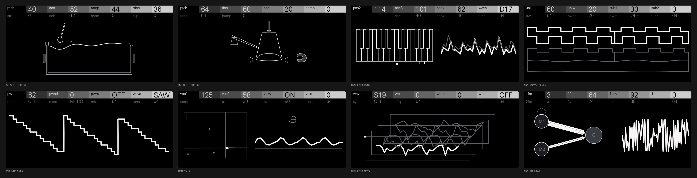

# OP-XY MNMD

The Elektron Machinedrum and Monomachine, written from scratch as engines for
the Teenage Engineering OP-XY, on the
[Open-XY SDK](https://github.com/etcetc000/open-xy).



- **The Machinedrum is MD KIT**, a drum kit of its synthesised families, TRX,
  EFM, P-I and GND. It plays like the OP-XY's Drumline: each of the 24 keys
  holds its own machine (kick, snare, toms, clap, rim, cowbell, hats, cymbals
  and more). Shift and the first encoder choose a key's machine, the encoders
  hold that machine's eight controls, and the project saves them.
- **MD E12, the sampled family, is build-it-yourself.** Its sounds are the
  Machinedrum ROM's own samples, which can't be shared, so it isn't in the
  open-xy.com builder or any release. Capture them from your own ROM and build
  it ([MD E12](#md-e12-mde12)). It plays as MD KIT does, with the same mixer on
  Shift, step locks and track filter.
- **Each Monomachine machine is its own engine**, played chromatically, with
  its SYN page's two rows as two pages of four encoders. A press of any
  encoder switches between them, as on the SDK's Macro Osc.

| Engine | ID | Machines |
| --- | --- | --- |
| MD KIT | `mdkit` | Four families, 33 machines: TRX BD, SD, XT, CP, RS, CB, CH, OH, CY, MA, CL, XC, B2; EFM BD, SD, XT, CP, RS, CB, HH, CY; P-I BD, SD, MT, ML, MA, RS, RC, CC, HH; GND SN, NS, IM |
| MD E12 (build it yourself) | `mde12` | E12's 16 machines, on samples you capture from your own ROM |
| MNM SWAVE-SAW | `mmsaw` | A stack of detuned saws with sub-octaves |
| MNM SWAVE-PULSE | `mmpulse` | Detuned pulses with a sweeping width and sub-octaves |
| MNM SWAVE-ENS | `mmens` | A four-voice chord of saws or pulses, with chorus |
| MNM SID-6581 | `mmsid` | Triangle, saw, pulse, mixed and noise, with a pulse-width sweep, ring and sync |
| MNM FM STAT | `mmstat` | Two modulators into one carrier, M1 with its decay and feedback |
| MNM FM PAR | `mmpar` | Three modulators into one carrier, each with its own depth or decay |
| MNM FM DYN | `mmdyn` | M1 with pitch and depth envelopes, M2 with its decay and feedback |
| MNM VO-6 | `mmvo6` | Vowels from two formants, with twenty consonants before them |
| MNM GND-SIN | `mmsin` | A pure sine at the played key |
| MNM GND-NOIS | `mmnois` | White noise turning red, and RES pitching it to the key |
| MNM DPRO-WAVE | `mmwave` | Its own S-sets, captured from your ROM, moved along WP |
| MNM DPRO-DDRW | `mmddrw` | Two D-waves, crossfaded, spread and bit-reduced |
| MNM DPRO-DENS | `mmdens` | A chord of up to four D-waves, each with a chorus |
| MNM DPRO-BBOX | `mmbbox` | Its 24 drum samples on 24 keys, from your own ROM |

All the DSP is fixed point, because the OP-XY's Blackfin has no floating
point. **This repository holds no Elektron code, firmware, ROM data or
samples.** The sounds were fitted by ear and by measurement against the
original ROMs running in an emulator. E12 and the DigiPRO machines need
samples and waves from the ROM. You capture those from your own ROM into a
folder outside the checkout, and without them those engines build silent.

**Status:** experimental. Every engine passes its tests, and MD KIT and the published
synths have been played on an OP-XY on OS 1.2.1. MD KIT's heaviest single voice measures 2.667% of the stock
block budget on the device (`opxy-drum-callback-v1`, three captures of v1.3.0's sound code), under the SDK's
recommended 3.5%, its own keys at its full 16 voices, saved as a project's are, 23.754%, and that heaviest voice on all 16 42.232%.
A single voice's worst block reaches 7.57% (PI-MT). In v1.3.0 the modal, cymbal and hat voices cost less, with the
same output: in the same firmware v1.2.2 measured 3.130%, 24.364% and 48.705%. Those figures time
its voices through the SDK's drum adapter, not stock's drum renderer, envelope or
mixing, and leave out the screen. TRX-SD's PTCH goes further than the original's, which barely moves: five semitones
either way, finely around its default, so a project that saved it away from the default 48 plays at
its new pitch: a saved 90 was 10 cents up and is now about 2.5 semitones up. The track menu's scramble doesn't change a kit yet
([open-xy#324](https://github.com/etcetc000/open-xy/issues/324)).

**The screens follow the amp envelope (SDK 1.10).** Every
Monomachine engine whose screen moves with a note now times that motion by the
track's own amp envelope (M2), with the OP-XY's own times and curves: it swells with the attack, holds
while the note is held and fades over the release, so it stops when the sound
does ([docs/SCREEN.md](docs/SCREEN.md#following-the-amp-envelope)). These
engines therefore target SDK 1.10, on the SDK's `staging` branch, and reach
the open-xy.com builder with its next release. Until then the builder keeps
installing the versions it pins ([docs/CATALOG.md](docs/CATALOG.md)).
Following the envelope changes nothing in the sound, so saved sounds and
projects play as before. A larger release setting is a shorter
release on the OP-XY, and the screens follow it that way. DPRO-WAVE and
DPRO-DDRW don't move with a note, the kits (MD KIT and MD E12) don't follow
the envelope because the OP-XY doesn't apply it to drum sounds, and DPRO-DENS
waits until its firmware links on SDK 1.10; they are unchanged.

## What you need

- macOS (the tools are written for it, though most of them run elsewhere).
- Python 3.12, Node 22, Homebrew's `llvm` and `lld`.
- The Open-XY SDK with drum-kit support. Upstream `staging` has it since
  pull requests [#121](https://github.com/etcetc000/open-xy/pull/121) and
  [#143](https://github.com/etcetc000/open-xy/pull/143) merged, with the
  two-page synth controls (#125 and its follow-ups). The kits' pan, level,
  filter and SRR need SDK 1.10, whose drum kits keep a key's own mixer
  settings on Shift, and their sends in 1% steps SDK 1.15. These tools build for
  OS 1.2.0 on the fork's branch below.
- To put the engines on a device: an OP-XY on **OS 1.2.0** exactly, a USB
  cable, and the Open-XY Blackfin toolchain.
- Only for E12 and DPRO's sounds, or for comparing against the originals:
  your own Machinedrum and Monomachine OS ROMs and the
  [gearmulator-md-mm](https://github.com/joelanders/gearmulator-md-mm)
  emulator.

## Setup

Clone this repository and the SDK side by side:

```bash
git clone https://github.com/mmockett/OP-XY-MNMD
git clone -b two-page-synths https://github.com/mmockett/open-xy
cd OP-XY-MNMD
```

The SDK must sit at `../open-xy`. Then install the compiler and give the SDK
a Python environment:

```bash
brew install llvm lld node
python3.12 -m venv ../open-xy/.venv
../open-xy/.venv/bin/pip install numpy==2.3.5
../open-xy/.venv/bin/python ../open-xy/sdk.py doctor --preview --cxx "$(brew --prefix llvm)/bin/clang++"
```

## Play it on the Mac

Everything up to flashing runs on the Mac, from the same C++ that goes on the
device:

```bash
python3 tools/make_engine.py
python3 tools/test_voices.py
../open-xy/.venv/bin/python ../open-xy/sdk.py test --machine machines/mdkit --cxx "$(brew --prefix llvm)/bin/clang++"
python3 tools/serve_bench.py
```

In order, these commands generate every engine in `machines/` from `voices/`
and `tools/catalog.py`, check each voice's fitted measures, run the SDK's
checks on an engine, and serve the bench.

The bench, at http://127.0.0.1:8930/, has every engine as a track, with a
step grid, a keyboard, the OP-XY screen and knobs. Space plays, 1 to 9 pick
a track, the keys A W S E D … play from C3, and you drag a knob to turn it.
The bench plays a kit as its first key's machine.

### E12 and DPRO samples (optional)

Build the emulator beside this folder (`../gearmulator-md-mm`, see
[reference/README.md](reference/README.md)), then run:

```bash
MD_ROM=/path/to/machinedrum-os.bin ../open-xy/.venv/bin/python tools/capture_e12.py
MM_ROM=/path/to/monomachine-os.bin ../open-xy/.venv/bin/python tools/capture_dpro.py
python3 tools/make_engine.py
```

The captures go to `~/Library/Application Support/OPXY-MD/private/`, and
`make_engine.py` copies the generated headers into the engines, where git
ignores them. Never commit them.

## Put it on the OP-XY

MD KIT and ten of the Monomachine engines are live in the
[open-xy.com](https://open-xy.com) builder, which builds them into a copy of
your own OS 1.2.1 with none of the tools here:
[MD KIT](https://open-xy.com/#preview/machines/mdkit),
[SWAVE-SAW](https://open-xy.com/#preview/machines/mmsaw),
[SWAVE-PULSE](https://open-xy.com/#preview/machines/mmpulse),
[SWAVE-ENS](https://open-xy.com/#preview/machines/mmens),
[SID-6581](https://open-xy.com/#preview/machines/mmsid),
[FM STAT](https://open-xy.com/#preview/machines/mmstat),
[FM PAR](https://open-xy.com/#preview/machines/mmpar),
[FM DYN](https://open-xy.com/#preview/machines/mmdyn),
[VO-6](https://open-xy.com/#preview/machines/mmvo6),
[GND-SIN](https://open-xy.com/#preview/machines/mmsin) and
[GND-NOIS](https://open-xy.com/#preview/machines/mmnois).
[docs/CATALOG.md](docs/CATALOG.md) lists the version it installs for each.
MD E12 and the DPRO engines need your own ROM's captures, so they aren't
there; build them as below.

Open-XY links these engines into a copy of your own OP-XY's OS, and you
install the result from the device's boot menu. It is unofficial and
experimental, and the SDK's checks cannot guarantee that a device can be
recovered. [docs/DEVICE.md](docs/DEVICE.md) has every step. In short:

1. Fetch the Blackfin toolchain: `../open-xy/.venv/bin/python ../open-xy/sdk.py toolchain fetch`.
2. Copy `os.ldr` off your OP-XY once, over the boot menu's MTP mode, to
   `~/Library/Application Support/OPXY-SDK/private/stock-1.2.0/os.ldr`.
3. Build: `python3 tools/build_firmware.py`. The build goes to
   `~/Library/Application Support/OPXY-MD/builds/NNN/`. Engines keep their
   numbers from build to build, so saved projects keep their machines.
4. Install: `python3 tools/install_firmware.py --copy` copies the build over
   MTP and keeps the files it replaces. Then press track 2 (exit) and track 5
   (write OS).
5. Pick a drum track and choose MD KIT (or MD E12, if you built it from your
   own ROM), or a synth track for a Monomachine engine.

To go back to stock, reinstall the official OS 1.2.0 update.

## How to play

### The drum kits

Load MD KIT on a drum track (or MD E12, if you built it from your own ROM).
The 24 keys start as the Machinedrum's default kit: BD, SD, three toms, CP,
RS, CB, CH, OH, RC, CC and four more machines (M1 to M4), then eight
variations, such as a second kick, snare or cowbell. MD KIT starts on the TRX kit, and its presets `trx`, `efm`
and `pi` load the TRX, EFM and P-I kits. Each kit's keys are listed in `tools/catalog.py`.

- **Choose a key's machine:** select the key and hold **Shift**. On MD KIT,
  **encoder 1** steps through all 33 machines, family by family (the cell
  shows the family over the machine: TRX over BD). On a self-built MD E12,
  **encoder 1** steps through its 16 machines (MACHINE over BD). Any key can
  hold any of the engine's machines.
- **Choke groups:** hold **Shift** and turn **encoder 2** to put the key in
  choke group 1, 2 or 3, or none. Keys in the same group cut each other off. A
  kit starts with CH, OH and RC in group 1 and the other keys in none.
- **Pan and level:** hold **Shift** and turn **encoder 3** to pan
  the key (PAN, -100 left to 100 right, 0 in the centre) and **encoder 4** to
  set its level (LEVEL, 0dB down to -30dB), as on the OP-XY's Drumline. A
  fast turn moves the pan further.
- **Filter and SRR:** hold **Shift** and press any encoder to move
  Shift to the second row (press again to come back). **Encoder 1** is the
  key's FILTER: turn left for a low-pass, from L8.0k down to L150, right for a
  high-pass, from H50 up to H4.0k, and back to the middle (OPEN) for none. **Encoder 2** is SRR, the
  Machinedrum's sample-rate reduction, from OFF through 22k down to 689 Hz.
  Every key has the second row, a machine with four or fewer controls too.
  **Encoders 3 and 4** (FX I and FX II) set the key's own sends: TRK follows
  the track's send, then 0 (dry) up to 100, whatever the track's send is. A
  kick can stay dry while the snare goes to the reverb, even with the track's
  sends at 0.
- **Both Shift rows at once:** while Shift is held the header shows both
  rows, the one the encoders turn bright and the other small and grey under or
  over it, as the two pages of controls are shown.
- **Eight controls a key:** the four encoders hold the machine's first four
  controls. **Press an encoder** to switch it to its alternate (controls 5
  to 8), and press it again to switch back. The labels and values follow the
  selected key's machine. A machine with fewer than eight controls leaves the
  rest blank, and a blank slot does nothing.
- **Tuning:** a key's pitch is its PTCH control, as on the Machinedrum. The
  note you play doesn't change it.
- **Parameter locks:** hold a step and turn an encoder to lock that control on
  the step. While you hold the step, the screen shows the values it plays.
- **Track filter:** on either kit, **M3** is the OP-XY's own filter, as on a synth
  track: switch it on, pick the type (svf, ladder, z lowpass, z hipass and the
  rest) and set cutoff, resonance, envelope amount and key tracking. Each hit
  gets its own filter and its own filter envelope (**M2** with **Shift**), after
  the key's own FILTER, so a dark key gets darker still. With M3 off the kit
  sounds exactly as it does without it. M3's second row has the track's FX I
  and FX II.
- **M3 locks:** hold a step and turn M3's encoders to lock the filter on that
  step, as on a synth. FX I and FX II lock from M3's second row or the mixer.
- **Shift locks:** hold a step, hold **Shift** and turn PAN or
  LEVEL (first row), or FILTER, SRR, FX I or FX II (second row), to lock that
  step's hits. LEVEL, FILTER and SRR lock the key's own setting plus an
  offset: level up to 30dB either way, FILTER and SRR across their whole range.
  PAN pushes the key's pan towards the left or the right, all the way at either
  end. FX I and FX II lock the hit's send itself, TRK or 0 to 100, whatever the
  key sends. Each hit keeps its locks while it rings, and the hits before it
  don't move. While you hold the step, the Shift row shows what it plays. A
  lock moves every key on its step, so put keys on separate steps to lock them
  apart. MACHINE and CHOKE don't lock.
- **Saving:** each key's machine, controls, choke group, pan, level, FILTER
  and SRR are saved with the project; its machine, controls, pan and level in
  presets too.

### MD E12 (`mde12`)

MD E12 plays the Machinedrum's sixteen E12 machines from the samples you
capture from your own ROM: BD, SD, HT, LT, CP, RS, CB, CH, OH, RC, CC, BR, TA,
TR, SH and BC. Its 24 keys start as the default kit on E12 machines, and everything
above applies to it: each key's machine and eight controls, the mixer on
Shift with step locks, and the track filter on M3. With no families, its
MACHINE cell is titled MACHINE.

| Encoder | Row 1 | Row 2 | Shift, row 1 | Shift, row 2 |
| --- | --- | --- | --- | --- |
| 1 | PTCH: the sample's speed, up to two octaves either way | STRT: starts the sample later | MACHINE | FILTER |
| 2 | DEC: its fall, none at 127 | RTRG: plays it again from STRT, up to 124 times, endlessly at 126 and 127 | CHOKE | SRR |
| 3 | HP: a two-pole high-pass, up to 6.3 kHz (SNAP on BD) | RTIM: the time between retrigs | PAN | FX I |
| 4 | The machine's own (below) | BEND: starts the pitch up to an octave away, gliding back | LEVEL | FX II |

The fourth control is each machine's own: HPQ, the high-pass's resonance, on
HT, LT, CP, CB, CH, CC, TA and TR; RING (SD), RATL (RS), BELL (RC), REAL (BR),
SLEW (SH) and BC (BC) crossfade to a second sample; STOP (OH) cuts the sample
short; on BD, SPLN sets how long SNAP, in HP's place, drives the kick up to
three times harder into a clip. FILTER and SRR work after the sample's own HP, so a key can be
high-passed by HP and darkened by FILTER at once.

The screen draws the key's sample as a strip of tape on a splicing block, its
recording as stripes: PTCH packs them closer, DEC fades them along the tape,
HP thins their lower halves, BEND crowds the first ones, STRT lays the cut-off
start above the block, RTRG and RTIM add splicing patches, and the fourth
control creases the tape, cuts it short or splices in the second sample.

To build it, capture the samples ([E12 and DPRO samples](#e12-and-dpro-samples-optional)),
then generate and build it with MD KIT:

```bash
python3 tools/make_engine.py mde12
../open-xy/.venv/bin/python ../open-xy/sdk.py test --machine machines/mde12 --cxx "$(brew --prefix llvm)/bin/clang++"
python3 tools/build_firmware.py mdkit mde12
```

Without the capture MD E12 still builds, and its screen and Shift rows work,
but every key is silent.

### The Monomachine engines

Load one on a synth track and play it chromatically.

- **Controls:** two pages of four. Page 1 is the top row of the machine's SYN
  page, page 2 the bottom row. Press any encoder to switch all four. The
  header shows both pages in place: the page you're editing at full size on
  the stepped bar, the other small and grey under or over it. Where the
  bottom row has no control, page 2 repeats the one above it.
- **Fine steps:** hold Shift while turning for a tenth of the rate. Choice
  controls, such as WAVE or MOD, move one choice a detent.
- **Presets:** each engine comes with a few presets of its own, in the preset
  browser: SID-6581 has saw, square, ring, sync and more.

#### GND-NOIS (`mmnois`)

Noise from white to red, as the Monomachine's, and with RES, noise pitched to
the key you play: tuned wind, a whistle, a noise bass.

| Page | Control | What it does |
| --- | --- | --- |
| 1 | ST | Lifts the level up to +2.9 dB while STON is off |
| 1 | RED | White noise at 0, through pink, to red at 127; loudest near 64 |
| 1 | STON | The original's stereo switch; with it on, ST does nothing (the OP-XY's synths are mono) |
| 1 | TUNE | Moves the sound two semitones either way: a whole tone on the pitch RES plays |
| 2 | RES | At 0, the original. Turned up, the noise narrows around the played note, from a breathy band to a whistle, at about the same level |

The key moves the noise as it does on the original: the red part passes a
high-pass at half the note, and white noise darkens as the key rises. RES
moves that high-pass up to the note and sharpens it, so the key and TUNE play
a pitch, in tune across the keyboard and at an even level. The presets are
White, Pink, Red and Loud, the original's, and Wind, Whistle and Bass, which
use RES.

Saved sounds keep their controls, and RES reads 0 in a project saved before
it, so it plays the original. Two things sound different from v1.2.3, both
measured on the original: the key now moves the red part (above), and white
noise is darker, most on high keys, at the same level (its centroid falls from
5.1 kHz at C1 to 2.7 kHz at C7, where v1.2.3's stayed at 5.7 kHz). Sounds with
RED up change most on low and high keys. No setting brings back the old sound.

### The screen

The screen draws the selected key's machine, or the Monomachine engine's,
from its controls. Each note you play strikes it: the drawing moves rather
than being replaced.

## Layout

| Path | What |
| --- | --- |
| `voices/` | The sound: one module per machine, with its view and its fitted tests ([docs/VOICES.md](docs/VOICES.md)) |
| `machines/<id>/` | One OP-XY engine, **generated** by `tools/make_engine.py`: don't edit it |
| `lib/` | Shared fixed-point DSP, tables and the screen library |
| `tools/` | The catalog, generators, bench server, captures and firmware build |
| `tools/art/` | The screen pipeline ([docs/SCREEN.md](docs/SCREEN.md)) |
| `bench/` | The bench page and its AudioWorklet |
| `reference/` | Measuring and fitting against the emulator ([reference/README.md](reference/README.md)) |
| `docs/` | The plan, the voice and screen guides, and the design handoff |

## Links

- [Open-XY SDK](https://github.com/etcetc000/open-xy), whose drum kits arrived in
  [#121](https://github.com/etcetc000/open-xy/pull/121)
- [open-xy-mdkit](https://github.com/etcetc000/open-xy-mdkit), a 24-key
  drum kit of MDKit's TRX, EFM and PI models for Open-XY
- [xy-format](https://github.com/kmorrill/xy-format), the OP-XY project format
- [gearmulator-md-mm](https://github.com/joelanders/gearmulator-md-mm), the
  Machinedrum and Monomachine emulator used as the reference
- Elektron's [Machinedrum](https://www.elektron.se/support-downloads/machinedrum)
  and [Monomachine](https://www.elektron.se/support-downloads/monomachine)
  manuals
- The [OP-1 design kit](https://squarewave-studio.github.io/op1-design-kit/),
  whose principles the screens follow

## Licence

MIT, as the Open-XY SDK is. See [LICENSE](LICENSE). Machinedrum and
Monomachine are trademarks of Elektron. This project is not affiliated with
Elektron or Teenage Engineering.
